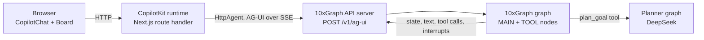

## What you will build

A task board with a chat assistant. You type a goal such as "plan a product launch". The assistant adds tasks to a board that is shown next to the chat, moves them between columns, and asks you to approve before it deletes finished tasks.

The backend is a 10xGraph `ReactAgent` served by the 10xGraph API server on `POST /v1/ag-ui`. The frontend is Next.js with CopilotKit, which speaks AG-UI natively.

## Architecture



## Agent, model and company

| Agent | Model | Company | Role |
|---|---|---|---|
| Task assistant (`backend/graph/agent.py`) | `gpt-5-mini` | OpenAI | Talks to the user, calls the board tools |
| Task planner (`backend/graph/planner.py`) | `deepseek-chat` | DeepSeek | Splits a goal into 3 to 5 steps, called from the `plan_goal` tool |

Both are 10xGraph graphs. The planner uses the OpenAI-compatible client with `base_url="https://api.deepseek.com"`, so no extra package is needed beyond the `openai` extra.

## AG-UI feature support (checked in the server source)

Checked in the API server source under `routers/ag_ui/` (router, service, event mapper) and in the integration guide.

| Feature | Supported | Used here | How |
|---|---|---|---|
| Streaming text | Yes | Yes | `TEXT_MESSAGE_START/CONTENT/END` |
| Tool calls and results | Yes | Yes | `TOOL_CALL_START/ARGS/END`, `TOOL_CALL_RESULT` |
| Reasoning | Yes | No | `REASONING_START` to `REASONING_END` |
| Shared state to the UI | Yes | Yes | `STATE_SNAPSHOT` with the fields you add to `AgentState` (not messages) |
| State from the UI to the graph | Yes | No | `RunAgentInput.state` becomes the run's start state; `context`, `context_summary`, `execution_meta` are ignored |
| Frontend (browser) tools | Yes | Yes | Sent in `RunAgentInput.tools`, offered for that run only; the run finishes with the call unanswered and CopilotKit starts a new run with the result. Disable with `ag_ui.allow_client_tools: false` |
| Human-in-the-loop | Yes | Yes | `interrupt()` becomes `RUN_FINISHED` with `outcome: {type: "interrupt"}`; CopilotKit `useInterrupt` resumes it |
| `STATE_DELTA` patches | No | No | Only full snapshots are sent |
| `MESSAGES_SNAPSHOT` | No | No | A reloaded browser starts with an empty chat unless CopilotKit stores messages |

## Key concepts

- `ag_ui.enabled` in `10xgraph.json`: mounts `POST /v1/ag-ui` on the API server.
- `AgentState` subclass (`BoardState`): the custom fields are the shared state.
- Tools that take `state`: they change the board in place; the server sends the new fields as a snapshot.
- `interrupt()` in `clear_done_tasks`: pauses for approval.
- `HttpAgent` from `@ag-ui/client` in the Next.js route: the CopilotKit runtime's link to the server.
- `useAgent`, `useFrontendTool`, `useInterrupt`: CopilotKit hooks for the board, the browser tool and the approval.

## Prerequisites

- Python 3.12 or newer, Node.js 20 or newer (or Docker).
- Keys: `OPENAI_API_KEY`, `DEEPSEEK_API_KEY`.
- Backend install: `pip install "10xgraph[openai]" "10xgraph-api[ag-ui]" python-dotenv` (see `backend/requirements.txt`).
- Frontend package versions in `frontend/package.json` use caret ranges (`@copilotkit/*` ^1.50.0, `@ag-ui/client` ^0.0.40). `frontend/package-lock.json` pins them (CopilotKit 1.82.0 and `@ag-ui/client` 0.0.40 at the time of writing), which ship the `@copilotkit/*/v2` import paths the app uses. The Dockerfile installs with `npm ci`, so Docker builds use exactly those versions.
- The frontend uses the `@copilotkit/react-core/v2` chat components, as in the guide, so `@copilotkit/react-ui` is not installed.

## Run it

With Docker:

```bash
cp .env.example .env      # add OPENAI_API_KEY and DEEPSEEK_API_KEY
docker compose up --build
```

Open http://localhost:3000. The API server is on http://localhost:8000.

Without Docker, in two terminals:

```bash
# 1. backend
cd backend
pip install -r requirements.txt
cp ../.env.example .env   # add your keys
10xgraph dev --config 10xgraph.json --port 8000 --no-open

# 2. frontend
cd frontend
npm install
GRAPH_API_URL=http://localhost:8000 npm run dev
```

## How it works

`backend/10xgraph.json` points at the compiled graph and turns on the endpoint:

```json
{
  "agent": "graph.agent:app",
  "ag_ui": { "enabled": true, "allow_client_tools": true }
}
```

`backend/graph/state.py` defines the shared state. These fields are what the board shows:

```python
class BoardState(AgentState):
    board_title: str = "My task board"
    tasks: list[dict[str, Any]] = Field(default_factory=list)
    next_id: int = 1
```

`plan_goal` in `backend/graph/agent.py` calls the DeepSeek planner graph and adds one task per step:

```python
steps = await plan_steps(goal)
for step in steps:
    _new_task(state, step, "medium")
```

`clear_done_tasks` pauses the run with `interrupt()`. The tool runs again after the user answers, so nothing with side effects comes before the call:

```python
decision = interrupt(
    value={"count": len(done), "titles": [t["title"] for t in done]},
    message=f"Delete {len(done)} finished task(s)?",
    reason="clear_done_approval",
    response_schema={...},
)
```

The browser tool `focus_task` exists only in the frontend. The system prompt tells the model to call it, and CopilotKit sends its schema with each run:

```tsx
useFrontendTool({
  name: "focus_task",
  parameters: z.object({ task_id: z.number() }),
  handler: async ({ task_id }) => { onFocus(task_id); return `Highlighted task ${task_id}`; },
});
```

The Next.js route handler connects CopilotKit to the endpoint:

```ts
graph: new HttpAgent({ url: `${GRAPH_URL}/v1/ag-ui` })
```

`components/Board.tsx` reads `useAgent({ agentId: "graph" }).agent.state`, and `components/Approval.tsx` renders the approval card with `useInterrupt`.

State is stored by an `InMemoryCheckpointer`, so threads are lost when the backend restarts. Use `PgCheckpointer` for durable threads.

## Expected output

Illustrative session:

```text
You:        Plan a product launch and mark the first step as doing.
Assistant:  I asked the planner and added 4 tasks. Task 1 is now doing.
            (board: TODO 3 tasks, DOING "Define launch goals", task 1 highlighted)
You:        Clear the finished tasks.
            (approval card: "Delete 2 finished task(s)?" -> Approve)
Assistant:  Deleted 2 finished task(s).
```

## Using a different model

Change the model string in `backend/graph/agent.py` or `backend/graph/planner.py`. For Anthropic, use `model="claude-sonnet-5-5"`, install `10xgraph[anthropic]` and set `ANTHROPIC_API_KEY`. For Google, use `model="gemini-2.5-flash"`, install `10xgraph[google-genai]` and set `GEMINI_API_KEY`.

## Next steps

- [RAG assistant app](../rag_assistant/)
- [Tools](../../tools/)
- [Streaming](../../streaming/)
