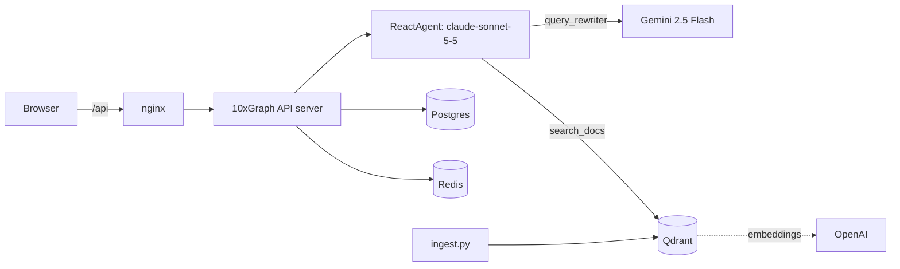

## What you will build

A documentation assistant for a fictional product called Lumen. You ask a question in a React chat UI. A ReAct agent rewrites the question into a search query, searches a Qdrant collection of documentation chunks, and answers with the source file named for each fact. The UI streams the answer and lists the cited sources taken from the tool results.

The stack runs with one `docker compose up`: the 10xGraph API server, an nginx-served frontend, Postgres and Redis for thread persistence, and Qdrant for vectors.

## Key concepts

- `ReactAgent`: prebuilt ReAct loop; wires the model node, tool node and routing.
- `PgCheckpointer`: stores thread state in Postgres with a Redis cache, so threads survive restarts.
- `QdrantStore` with `OpenAIEmbedding`: vector search over the knowledge base.
- `system_user_id("docs_kb")`: reserved owner for shared data such as a RAG knowledge base.
- `call_llm`: single-turn call used by the query rewriter, provider chosen from the model name.
- `10xgraph.json`: tells the 10xGraph API server which graph to load and configures rate limiting and auth.
- `TenxGraphClient` from `10xgraph-client`: `stream()`, `threads()`, `threadMessages()`, `deleteThread()`.
- `tenxgraph.qa.testing`: runs graph logic in tests with no LLM.

## Prerequisites

- Docker with Compose v2 (to run the full stack).
- API keys: `ANTHROPIC_API_KEY`, `OPENAI_API_KEY`, `GEMINI_API_KEY`.
- Without Docker: Python 3.12+, Node 20+, and Postgres, Redis and Qdrant reachable on localhost.

```bash
pip install "10xgraph[anthropic,openai,google-genai,qdrant,pg_checkpoint]" 10xgraph-api
```

## Run it

### With Docker Compose

```bash
cd examples/apps/rag_assistant
cp .env.example .env            # add the three API keys
docker compose up --build
docker compose run --rm ingest  # one time: loads backend/data into Qdrant
```

Open http://localhost:3000. The API is on http://localhost:8000 (bound to localhost only).

`ingest` sits behind a Compose profile, so `docker compose up` does not start it. Run it again after you change files in `backend/data/`; chunk ids are stable, so it updates instead of duplicating.

### Without Docker

```bash
cd examples/apps/rag_assistant
cp .env.example .env
docker compose up -d postgres redis qdrant   # or run your own instances

cd backend
pip install -r requirements.txt
python ingest.py
10xgraph dev --host 0.0.0.0 --port 8000 --no-open      # reads 10xgraph.json and ../.env values

cd ../frontend
npm install
npm run dev                                  # http://localhost:5173, proxies /api to :8000
```

`10xgraph.json` points `env` at `../.env`, so the API reads the same `.env` file as Docker Compose. Inside the container that file does not exist and is skipped; Compose passes the variables instead.

### Tests

```bash
cd backend && pytest tests
```

The tests replace the Qdrant store and the Gemini call with fakes and use `QuickTest` for the graph, so they need no keys and no services.

## How it works

### Agent to model to company

| Agent / step | Model | Company | Why |
|---|---|---|---|
| Chat agent (`ReactAgent`, `graph/agent.py`) | `claude-sonnet-5-5` | Anthropic | Tool use and grounded, cited answers |
| Query rewriter (`graph/tools.py`) | `gemini-2.5-flash` | Google | Fast and cheap for a short rewrite |
| Embeddings (`graph/store.py`) | `text-embedding-3-small` | OpenAI | Vectors for ingest and search |

### Architecture



### The graph

`graph/agent.py` builds the agent and exports the compiled graph as `app`. `10xgraph.json` points at it with `"agent": "graph.agent:app"`.

```python
react_agent = ReactAgent(
    model="claude-sonnet-5-5",
    system_prompt=SYSTEM_PROMPT,
    tools=[query_rewriter, search_docs],
    trim_context=True,
)
app = react_agent.compile(checkpointer=checkpointer, store=get_store())
```

Passing `store=` to `compile()` means the server's shutdown also releases the Qdrant client.

### The tools

`query_rewriter` calls Gemini through `call_llm`. `search_docs` queries Qdrant as the knowledge-base owner and returns JSON the UI can read:

```python
results = await get_store().asearch(KB_CONFIG, query, limit=limit)
return json.dumps(format_hits(results))
```

`KB_CONFIG` holds `{"user_id": system_user_id("docs_kb"), "collection": "docs_kb"}`. `ingest.py` writes with the same config, so both sides always agree on the owner.

### The frontend

`frontend/src/useChat.ts` streams with `client.stream(...)` and a `thread_id` in `config`. Assistant text chunks fill the bubble. Messages with role `tool` carry the `search_docs` output, which is parsed into the sources list under the answer. `ThreadList` uses `client.threads()` and `client.deleteThread()`; opening a thread reloads history with `client.threadMessages()`. No UI component library is used; the components are plain React.

nginx proxies `/api/` to the API with buffering off, which streaming needs.

## API endpoints used

| Endpoint | Used for |
|---|---|
| `POST /v1/graph/stream` | Streaming a run (`client.stream`) |
| `GET /v1/threads` | Thread list |
| `GET /v1/threads/{id}/messages` | Thread history |
| `DELETE /v1/threads/{id}` | Delete a thread |
| `GET /ping` | Health checks |

## Expected output

Illustrative. Ask "What does the Team plan cost and how long is data kept?" after ingesting:

```text
Team is $29 per seat per month and keeps data for 90 days (source: pricing.md).

Sources (1)
  pricing.md
    Plans (score 0.71)
```

Ingest prints:

```text
ingested api-limits.md
ingested getting-started.md
ingested pricing.md
ingested security.txt
done: 9 chunks
```

## Production notes

- **Auth.** This demo runs with `"auth": null`. For production set `"auth": "jwt"` in `10xgraph.json`, set `JWT_SECRET_KEY` and `JWT_ALGORITHM`, and pass `authToken` to `TenxGraphClient` in `frontend/src/client.ts`. Thread ownership is then enforced per user. Use `"auth": {"method": "custom", "path": "module:Class"}` for your own identity provider.
- **Mode and CORS.** Compose sets `MODE=development`. In `production` the server refuses wildcard `ORIGINS` and `ALLOWED_HOST`; set both to your real domain and drop `MODE: development`.
- **Rate limiting.** `10xgraph.json` enables Redis-backed limits, 60 requests per 60 seconds per IP. Switch `"by"` to `"user"` once auth is on, and set `trusted_proxy_headers` when running behind a load balancer.
- **Graceful shutdown.** The server handles SIGTERM itself: it stops taking new work, lets in-flight runs finish, then calls `aclose()` on the compiled graph, which releases Postgres, Redis and Qdrant. The image uses gunicorn with `--graceful-timeout 600`; keep your orchestrator's grace period at least that long (`stop_grace_period` here, `terminationGracePeriodSeconds` on Kubernetes).
- **Secrets and data.** Keep `.env` out of the image (`.dockerignore` does). Change the Postgres password in `docker-compose.yml` and do not publish the Postgres, Redis or Qdrant ports.

## Using a different model

Change the model string in `graph/agent.py` and install the matching extra. For example `model="gpt-5-mini"` needs the `openai` extra, and `model="gemini-2.5-flash"` needs `google-genai`. Provider detection comes from the model name; no `provider=` argument is needed. The rewriter model is a string in `graph/tools.py` and the embedding model is in `graph/store.py`. If you change the embedding model, re-run `ingest.py` into a fresh collection, since vector sizes must match.

## Next steps

- [Long-term memory](../../long_term_memory/) for per-user memory next to this shared knowledge base.
- [Streaming](../../streaming/) for more on streamed chunks.
- [Testing agents without an LLM](../../testing/) for more on `tenxgraph.qa.testing`.
