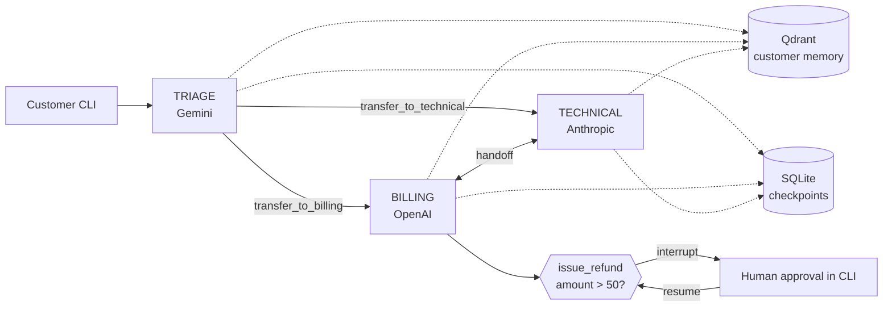

## What you will build

A command-line support desk for a software company. A triage agent greets the customer and routes the request. A billing agent can look up orders and issue refunds. A technical agent searches a knowledge base and runs diagnostics. The three agents hand the customer to each other with `SwarmAgent`.

Refunds above $50 pause the run and ask a person in the terminal to approve or decline. The conversation is saved in SQLite, and notes about each customer are stored in a local Qdrant collection, so a returning customer is recognised on the next run.

## Models used: one company per agent

| Agent | Model | Company | Why |
|---|---|---|---|
| Triage | `gemini-2.5-flash` | Google | Routing is a short classification task, so a fast, low-cost model fits. Thinking is turned off. |
| Billing | `gpt-5-mini` | OpenAI | Reliable tool calling and argument filling for money-related calls such as `issue_refund`. |
| Technical support | `claude-sonnet-5-5` | Anthropic | Longer troubleshooting answers with numbered steps from several tool results. |

The model strings are written in `agents.py`. Nothing else changes when you swap one: `SwarmAgent` only sees `Agent` objects. Memory embeddings use OpenAI `text-embedding-3-small`, so `OPENAI_API_KEY` is required even if you change the billing model.

## Key concepts

- `SwarmAgent` and `SwarmMemberConfig`: peer-to-peer handoff. `transfer_to_<name>` tools are generated and routed for you.
- `interrupt()` (`tenxgraph.utils`): pauses a tool or node and returns the resume value on the next run.
- `pending_interrupt(state)`: reads the pending request from the state returned by `ainvoke`.
- `SqliteCheckpointer`: saves threads in one local file, with no external service.
- `MemoryConfig` with `UserMemoryConfig`: long-term, per-user memory in `QdrantStore`. `retrieval_mode="preload"` injects matches into the request; `"postload"` gives the model `user_memory_tool` to search and remember.
- Injected `config` argument: tools read `config["user_id"]`, so the model cannot ask for another customer's data.

## Prerequisites

```bash
pip install "10xgraph[google-genai,openai,anthropic,qdrant,sqlite_checkpoint]" python-dotenv
export GEMINI_API_KEY=...
export OPENAI_API_KEY=...
export ANTHROPIC_API_KEY=...
```

No Docker services are needed. Qdrant and SQLite files are created under `examples/use_cases/customer_support/data/`.

## Run it

```bash
python examples/use_cases/customer_support/main.py
```

Sample customers are `C-1001` (two orders) and `C-1002`. Type `quit` to exit. Start again with the same id to continue the thread.

## Architecture



## How it works

**Agents with different models.** `agents.py` builds three `Agent` objects and passes them to `SwarmAgent`. Handoff tools are added to each agent's `ToolNode` automatically.

```python
billing = Agent(
    model="gpt-5-mini",
    system_prompt=prompts.BILLING,
    tool_node=ToolNode([lookup_order, issue_refund]),
    memory=postload,
)
```

**Memory.** One `QdrantStore` is shared. Triage uses a preload config, so memories for the latest user message are added to its request. Billing and technical use postload, so they get `user_memory_tool` and can write notes.

```python
postload = MemoryConfig(
    store=store,
    retrieval_mode="postload",
    limit=5,
    user_memory=UserMemoryConfig(),
    agent_memory=None,
)
```

Memory needs a non-empty `user_id` in the run config, and `main.py` sets it to the customer id.

**Approval.** `issue_refund` in `tools.py` calls `interrupt()` before the refund is recorded:

```python
decision = interrupt(
    {"order_id": order_id, "amount": amount, "reason": reason},
    message=f"Approve a ${amount:.2f} refund on {order_id}?",
    reason="refund_approval",
    response_schema={...},
)
```

On resume the tool runs again from the top, so the refund is recorded only after `interrupt()` returns. The schema is checked when you resume, so `{"approved": "yes"}` is rejected.

**The CLI loop.** `main.py` asks for the answer while the state still has a pending interrupt:

```python
while (request := pending_interrupt(result["state"])) is not None:
    result = await app.ainvoke(
        {"resume": ask_reviewer(request), "resume_interrupt_id": request.id},
        config,
        response_granularity=ResponseGranularity.FULL,
    )
```

`ResponseGranularity.FULL` is needed so the result includes the state. `resume_interrupt_id` makes a stale answer fail instead of approving the wrong request.

**Persistence.** Each customer has one thread, `support-<id>`, saved by `SqliteCheckpointer`. Every new message starts at `TRIAGE` again, which keeps routing simple; the earlier messages are still in the thread.

## Expected output

Illustrative; actual wording depends on the models.

```text
Customer id [C-1001]:
you: I was charged twice for my annual plan, please refund ORD-5001.
[approval needed] Approve a $240.00 refund on ORD-5001?
  details: {'order_id': 'ORD-5001', 'amount': 240.0, 'reason': 'duplicate charge'}
  approve? [y/N] y
  note for the customer (optional): duplicate confirmed
assistant: Your $240.00 refund for ORD-5001 has been approved and issued.
```

## Using a different model

Change the model string in `agents.py` and install the matching extra. For example, `model="claude-sonnet-5-5"` for billing needs the `anthropic` extra and `ANTHROPIC_API_KEY`; `model="gemini-2.5-flash"` needs `google-genai` and `GEMINI_API_KEY`. To keep one company per agent, move the replaced model to a different agent.

## Next steps

- [Human in the loop](../../human_in_the_loop/)
- [Swarm handoffs](../../multi_agent/)
- [Long-term memory](../../long_term_memory/)
