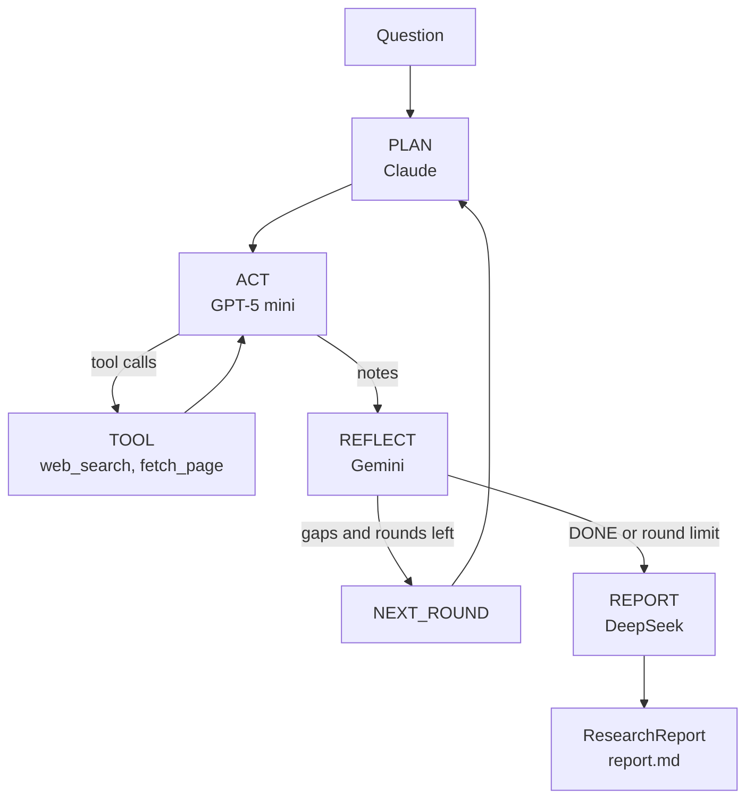

## What you will build

A command-line research assistant. You ask a question, and a graph runs a plan, act, reflect loop. The planner writes search steps, the actor searches the web and reads pages, and a reviewer decides whether the question is answered or sends the planner back to fill gaps. A final step turns the notes into a typed `ResearchReport`, which is printed and saved as markdown.

Progress streams to the terminal with `astream`, so you see each phase, its text and each tool call as it happens.

## Models used: one company per phase

| Phase | Model | Company | Why |
|---|---|---|---|
| Plan | `claude-sonnet-5-5` | Anthropic | Breaking a vague question into precise search steps benefits from strong reasoning. |
| Act | `gpt-5-mini` | OpenAI | Many short tool calls (search, fetch, summarise). A small, fast model keeps this loop cheap. |
| Reflect | `gemini-2.5-flash` | Google | A second opinion from a different model family is less likely to repeat the actor's blind spots. |
| Report | `deepseek-chat` | DeepSeek | Reformatting notes into JSON is simple, and DeepSeek is inexpensive. It runs through its OpenAI-compatible endpoint. |

## Key concepts

- `StateGraph` with a custom `AgentState` subclass: counts reflection rounds.
- `Agent(model=...)`: each phase is a separate agent; the provider is detected from the model string.
- `Agent(base_url=..., api_key=...)`: points the OpenAI client at DeepSeek.
- `ToolNode` and `google_web_search` / `fetch_url` from `tenxgraph.prebuilt.tools`.
- `add_conditional_edges`: loops ACT with TOOL, and REFLECT back to PLAN until `[DONE]`.
- `CompiledGraph.astream`: yields `StreamChunk` objects (`updates`, `message`, `error`).
- Pydantic `ResearchReport`: validates the final JSON.

## Why not PlanActReflectAgent

`PlanActReflectAgent` is the prebuilt version of this loop. Its constructor takes `model`, `plan_model` and `reflect_model`, but the ACT node is a `ToolNode`: it executes the tools the planner asked for and has no model. So the act step cannot run on OpenAI while planning runs on Claude. `graph.py` therefore builds the same shape by hand, with ACT as an `Agent`, a tool loop, and a report node. If you do not need a separate act model, `PlanActReflectAgent(model=..., plan_model=..., reflect_model=..., tools=[...])` is shorter.

## Prerequisites

```bash
pip install "10xgraph[anthropic,openai,google-genai]" python-dotenv
export ANTHROPIC_API_KEY=...
export OPENAI_API_KEY=...
export GEMINI_API_KEY=...      # or GOOGLE_API_KEY; also used by google_web_search
export DEEPSEEK_API_KEY=...
```

## Run it

```bash
python examples/use_cases/research_assistant/main.py "How do solid-state batteries work?"
```

Without an argument it uses a default question. The report is written to `examples/use_cases/research_assistant/output/report.md`.

## Architecture



## How it works

**One agent per phase.** `graph.py` creates four agents, each with a literal model string:

```python
planner = Agent(model="claude-sonnet-5-5", system_prompt=prompts.PLAN)
actor = Agent(model="gpt-5-mini", system_prompt=prompts.ACT, tool_node=tool_node)
reflector = Agent(model="gemini-2.5-flash", system_prompt=prompts.REFLECT)
```

DeepSeek uses the OpenAI client with a different endpoint:

```python
writer = Agent(
    model="deepseek-chat",
    base_url="https://api.deepseek.com",
    api_key=os.environ["DEEPSEEK_API_KEY"],
    system_prompt=prompts.REPORT,
    reasoning_config=None,
)
```

**A text-only view per phase.** The `stage()` helper hides tool calls and tool output from the plan, reflect and report agents, and appends one closing instruction. The actor sees everything, because it owns the tool loop. The real state is restored after the agent call, so nothing is lost.

**Search.** `tools.py` wraps two prebuilt tools to cap their output at 5,000 characters. `google_web_search` makes its own Gemini call with Google Search grounding. That call does not depend on the agent that invoked the tool, so GPT-5 mini can use it. To use another provider such as Tavily, replace the `web_search` function; the rest of the graph does not change.

**Loop control.** After REFLECT, `after_reflect` ends the loop when the reply contains `[DONE]` or after `MAX_ROUNDS` passes. Otherwise `NEXT_ROUND` increments `state.rounds` and routes back to PLAN.

**Structured report.** The REPORT prompt includes `ResearchReport.model_json_schema()` and `report.py` validates the reply with `ResearchReport.model_validate_json`. `output_schema=` is not used for DeepSeek: on an OpenAI-compatible client it is sent as a JSON Schema response format, which DeepSeek does not document. If your provider supports JSON Schema output, pass `output_schema=ResearchReport` to the writer agent and skip the prompt.

**Streaming.** `main.py` prints the node name from `updates` chunks, text from `message` deltas, and tool names from complete messages. REPORT deltas are collected silently and parsed at the end.

## Expected output

Illustrative; text varies by run.

```text
--- PLAN ---
1. Find how solid-state electrolytes conduct ions ...
--- ACT ---
[tool calls] web_search
[tool calls] fetch_page
--- REFLECT ---
All parts of the question are answered with sources. [DONE]
--- REPORT ---
# Solid-state vs lithium-ion batteries
...
saved: examples/use_cases/research_assistant/output/report.md
```

## Using a different model

Change the model string in `graph.py` and install the matching extra, for example `gpt-5-mini` for the planner needs `openai` and `OPENAI_API_KEY`. For another OpenAI-compatible service, keep the `Agent(base_url=..., api_key=...)` form and change the URL and key. To keep one company per phase, move the replaced model to another phase.

## Next steps

- [Plan, act, reflect](../../multi_agent/)
- [Structured output](../../structured_output/)
- [Streaming](../../streaming/)
